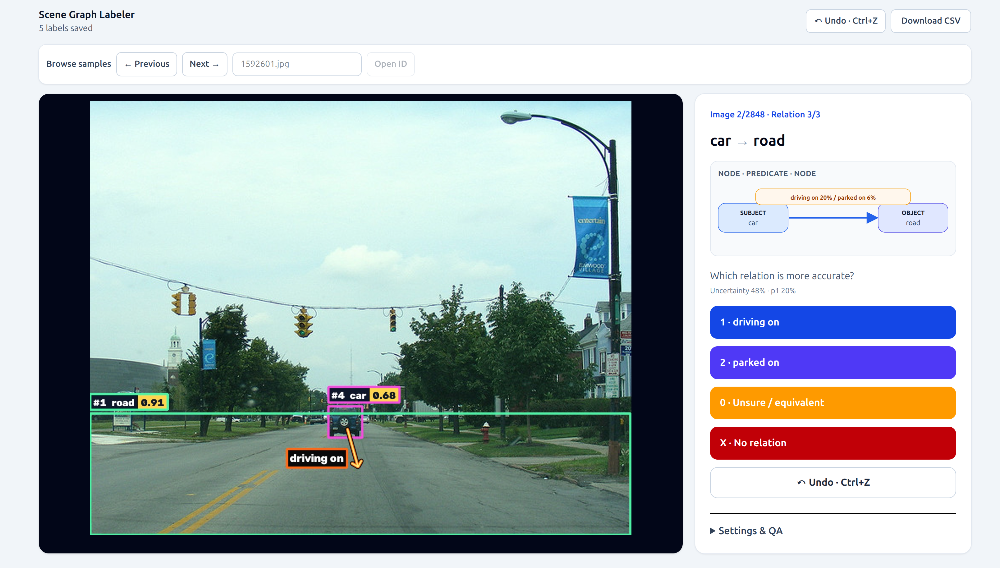

# Scene Graph Preference Alignment & Active Learning Toolkit

<p align="center">
  
</p>

An end-to-end human preference alignment and active uncertainty-guided annotation framework for **Two-Stage Scene Graph Generation (SGG)** on the **Panoptic Scene Graph (PSG)** benchmark.

This toolkit enables:
1. **Active Uncertainty-Guided Annotation GUI**: Interactive React + Vite frontend backed by a high-performance FastAPI server running two-stage YOLO12m-REACT++ inference to query human preferences on the most ambiguous predicate candidates.
2. **Reinforcement Learning from Human Preferences (RLHP)**: Fine-tunes relation projection layers using a tripartite objective:
   $$\mathcal{L}_{\mathrm{total}} = \mathcal{L}_{\mathrm{pref}} + \lambda_{\mathrm{KL}}\mathcal{L}_{\mathrm{KL}} + \lambda_{\mathrm{proto}}\mathcal{L}_{\mathrm{proto}}$$
   combining Bradley-Terry preference loss, masked KL retention, and prototype anchoring to eliminate catastrophic semantic drift.
3. **Comprehensive Analysis & Benchmark Evaluation**: Complete suite of tools to evaluate SGDet / PredCLS on PSG test, generate publication-grade training dynamics, per-predicate recall shifts, and qualitative scene graph grids.
4. **Academic Publication Report**: A full 9-page research report with complete LaTeX sources and precompiled PDF under [`report/`](report/).

---

## Table of Contents

- [System Architecture](#system-architecture)
- [Directory Structure](#directory-structure)
- [Installation](#installation)
- [Quick Start: Annotation GUI](#quick-start-annotation-gui)
- [RLHP Training & Ablation Pipeline](#rlhp-training--ablation-pipeline)
- [PSG Benchmark Evaluation](#psg-benchmark-evaluation)
- [Analysis & Visualization Suite](#analysis--visualization-suite)
- [Academic Report](#academic-report)
- [Citation & Contributor Attribution](#citation--contributor-attribution)

---

## System Architecture

```
                                  ┌────────────────────────┐
                                  │  Input Scene Image(s)  │
                                  └───────────┬────────────┘
                                              │
                                              ▼
                                 Stage 1: Frozen YOLO12m
                                 (Box Localization & mAP)
                                              │
                                              ▼
                             Stage 2: REACT++ Relation Encoder
                                              │
                                              ▼
                        ┌──────────────────────────────────────────┐
                        │   Active Uncertainty-Selection Module    │
                        │ (Relative Margin: (p1 - p2) / (p1 + p2)) │
                        └─────────────────────┬────────────────────┘
                                              │
                                              ▼
                               ┌────────────────────────────┐
                               │  Interactive Labeler GUI   │
                               │   (FastAPI + React/Vite)   │
                               └──────────────┬─────────────┘
                                              │ Human Feedback
                                              ▼
                         ┌────────────────────────────────────────┐
                         │       Audited Preference Dataset       │
                         └────────────────────┬───────────────────┘
                                              │
                                              ▼
                         ┌────────────────────────────────────────┐
                         │        Tripartite RLHP Trainer         │
                         │  - Bradley-Terry Preference Loss       │
                         │  - Masked KL Retention (55 classes)    │
                         │  - Prototype Cosine Anchor (57 classes)│
                         └────────────────────┬───────────────────┘
                                              │
                                              ▼
                         ┌────────────────────────────────────────┐
                         │   Aligned YOLO12m-REACT++ Checkpoint   │
                         │  (mR@50: +0.57%, F1@50: +0.36%,        │
                         │   Bbox mAP strictly invariant: 56.57%) │
                         └────────────────────────────────────────┘
```

---

## Directory Structure

```
scene_graph_tool/
├── README.md                          # Toolkit guide & quickstart
├── requirements.txt                   # Python dependencies for API & tools
├── psg_labels.json                    # PSG object & predicate taxonomy dictionary
├── scene_graph_preferences3.csv       # Curated & audited human preference dataset (510 records)
├── relation_selection_comparison.csv  # Uncertainty vs. probability selection benchmark data
│
├── server.py                          # FastAPI backend serving inference & React static UI
├── batch_session.py                   # Batch inference engine & relative-margin selector
├── app.py                             # Standalone / fallback annotation GUI
├── frontend/                          # React 18 + Vite + TailwindCSS interactive UI
│   ├── package.json
│   ├── src/                           # UI components, canvas overlays, shortcuts
│   └── vite.config.ts
│
├── rlhp.py                            # CLI Dispatcher (audit, train, evaluate, promote, rollback)
├── train_rlhp_custom.py               # Full RLHP engine (BT loss + Masked KL + Proto Anchor)
├── train_rlhp_pure_preference.py      # Baseline ablation trainer (unregularized preference)
├── evaluate_rlhp_epochs.py            # Checkpoint evaluator on PSG test benchmark (SGDet/PredCLS)
├── run_ablation_tau01.sh              # 4-way loss ablation reproduction runner
│
├── plot_rlhp_training.py              # Figure 3: 4-panel optimization dynamics generator
├── plot_pure_pref_retention.py        # Figure 5: Catastrophic semantic drift generator
├── visualize_preference_dataset.py    # Figure 2: Class distribution & uncertainty pairs
├── visualize_epoch_metrics.py         # Figure 4: PSG test mR@K trajectories
├── visualize_predicate_improvements.py# Figure 6: 56 categories recall shifts
├── visualize_qualitative_results.py   # Figure 7: Qualitative comparison grid generator
├── compare_relation_selection.py      # Table 1: Uncertainty vs Top-Prob selection evaluator
├── compare_psg_checkpoints.py         # Multi-checkpoint comparison tool
├── extract_parquet_images.py          # HuggingFace Parquet dataset image extractor
├── make_label.py                      # Category dictionary mapping helper
│
├── test_batch_session.py              # Unit tests for batch session inference
├── test_server_service.py             # Integration tests for FastAPI endpoints
├── test_rlhp.py                       # Unit tests for RLHP mathematical objectives & audits
├── test_extract_parquet_images.py     # Unit tests for Parquet extraction
│
├── doc/
│   ├── REACTPP_SHAPE_FLOW.md          # Tensor shape flow and projection architecture
│   └── plan_rlhp.md                   # RLHP mathematical formulation & gating spec
│
└── report/                            # Academic Research Report
    ├── main.tex                       # LaTeX source (9-page publication layout)
    ├── main.pdf                       # Compiled publication report PDF
    ├── references.bib                 # BibTeX citations
    └── figures/                       # High-resolution publication figures (Fig 1–7)
```

---

## Installation

### 1. Python Environment Setup
From the repository root:
```bash
# Recommended Python 3.10+
pip install -r requirements.txt
pip install -r scene_graph_tool/requirements.txt
```

### 2. Build Frontend UI (React + Vite)
```bash
cd scene_graph_tool/frontend
npm install
npm run build
cd ../..
```

---

## Quick Start: Annotation GUI

Serve both the REST API and the interactive web interface with a single command:

```bash
python scene_graph_tool/server.py \
  --checkpoint checkpoint/best_model.pth \
  --config checkpoint/config.yml \
  --yolo-checkpoint checkpoint/PSG_yolo12m_backbone.pt \
  --psg-dir scene_graph_tool/psg_labels.json
```

Navigate to `http://localhost:7860` in your browser.

### Features:
- Upload images as individual files or bundled ZIP archives.
- Automatic **Stage 1 YOLO12m** object detection and **Stage 2 REACT++** relation candidate ranking.
- Active uncertainty sampling selects candidate pairs with minimal relative margin:
  $$\Delta_{\mathrm{rel}} = \frac{p_1 - p_2}{p_1 + p_2}$$
- Autosaved annotations with provenance checksums, model hashes, and export to CSV/JSON.

### Keyboard Shortcuts:
| Key | Action |
| :---: | :--- |
| `1` / `2` | Select Candidate Predicate 1 / 2 |
| `0` | Neutral preference (Tie: `[0.5, 0.5]`) |
| `X` | Both Wrong / No Relation (`[0.0, 0.0]`) |
| `S` | Skip Sample |
| `Ctrl+Z` / `Z` | Undo previous action |

---

## RLHP Training & Ablation Pipeline

### 1. Audit Preference Dataset
Verify data integrity and prevent PSG test set contamination:
```bash
python scene_graph_tool/rlhp.py audit \
  --sessions scene_graph_tool/scene_graph_preferences3.csv \
  --output scene_graph_tool/rlhp_runs/audit
```

### 2. Train Full RLHP Model
Fine-tune relation projection head with Bradley-Terry preference loss, masked KL retention ($\lambda_{\mathrm{KL}}=20$), and prototype anchor ($\lambda_{\mathrm{proto}}=20$):
```bash
python scene_graph_tool/train_rlhp_custom.py \
  --checkpoint checkpoint/best_model.pth \
  --config checkpoint/config.yml \
  --yolo-checkpoint checkpoint/PSG_yolo12m_backbone.pt \
  --preference-csv scene_graph_tool/scene_graph_preferences3.csv \
  --output-dir scene_graph_tool/rlhp_runs/full_rlhp \
  --epochs 5 \
  --lr 2e-6 \
  --tau 0.1 \
  --lambda-kl 20.0 \
  --lambda-proto 20.0
```

### 3. Run Complete 4-Way Loss Ablation
Reproduce all ablation variants (Pure Preference, +Proto Anchor, +KL Retention, Full RLHP):
```bash
bash scene_graph_tool/run_ablation_tau01.sh
```

---

## PSG Benchmark Evaluation

Evaluate checkpoint across all PSG test images ($2,177$ images) on SGDet and PredCLS:
```bash
python scene_graph_tool/evaluate_rlhp_epochs.py \
  --run-dir scene_graph_tool/rlhp_runs/full_rlhp \
  --config checkpoint/config.yml \
  --yolo-checkpoint checkpoint/PSG_yolo12m_backbone.pt
```

### Benchmark Summary (PSG Test SGDet):
| Model Configuration | mR@20 | mR@50 | mR@100 | R@50 | F1@50 | Bbox mAP |
| :--- | :---: | :---: | :---: | :---: | :---: | :---: |
| Baseline YOLO12m-REACT++ | 23.28 | 26.37 | 28.28 | **38.25** | 31.22 | **56.57** |
| Preference Only (Unregularized) | 18.92 | 21.21 | 22.57 | 35.82 | 26.64 | 56.57 |
| Preference + Prototype Anchor | 21.24 | 24.51 | 26.18 | 37.31 | 29.58 | 56.57 |
| Preference + KL Retention | 22.93 | 26.21 | 27.88 | 37.56 | 30.87 | 56.57 |
| **Full RLHP (Tuned)** | **23.57** | **26.95** | **28.69** | 38.14 | **31.58** | **56.57** |

---

## Analysis & Visualization Suite

Generate all figures and tables included in the research report:

```bash
# Figure 2: Preference Dataset & Uncertainty Pairs Distribution
python scene_graph_tool/visualize_preference_dataset.py

# Figure 3: Four-Panel Optimization Diagnostics
python scene_graph_tool/plot_rlhp_training.py

# Figure 4: Epoch-wise Macro Recall Curves
python scene_graph_tool/visualize_epoch_metrics.py

# Figure 5: Catastrophic Semantic Drift Dynamics
python scene_graph_tool/plot_pure_pref_retention.py

# Figure 6: Per-Predicate SGDet Recall Shifts (All 56 classes)
python scene_graph_tool/visualize_predicate_improvements.py

# Figure 7: Qualitative Visual Comparison Grid
python scene_graph_tool/visualize_qualitative_results.py

# Table 1: Selection Strategy Comparison
python scene_graph_tool/compare_relation_selection.py
```

---

## Academic Report

The complete scientific report is available under [`report/`](report/):
- **[`report/main.pdf`](report/main.pdf)**: Precompiled 9-page research paper.
- **[`report/main.tex`](report/main.tex)**: Complete LaTeX source code.

To recompile the document locally:
```bash
cd scene_graph_tool/report
tectonic main.tex
# or pdflatex main.tex && bibtex main && pdflatex main.tex && pdflatex main.tex
```

---

## Citation & Contributor Attribution

If you use this toolkit, preference learning framework, or benchmark code in your research, please cite:

```bibtex
@article{phan2026humanpref_sgg,
  title={Human Preference Alignment for Two-Stage Scene Graph Generation: YOLO12m-REACT++ on Panoptic Scene Graphs},
  author={Phan, Quoc Anh},
  institution={Vision \& Language Navigation Team, VinRobotics},
  year={2026}
}

@inproceedings{neau2024reactpp,
  title={REACT++: Efficient Cross-Attention for Real-Time Scene Graph Generation},
  author={Neau, Maelic and others},
  booktitle={Proceedings of the European Conference on Computer Vision (ECCV)},
  year={2024}
}

@inproceedings{yang2022psg,
  title={Panoptic Scene Graph Generation},
  author={Yang, Jingkang and Ang, Yi Zhe and Guo, Zujin and Zhou, Kaiyang and Zhang, Wayne and Liu, Ziwei},
  booktitle={Proceedings of the European Conference on Computer Vision (ECCV)},
  year={2022}
}
```

---

## License

This project is licensed under the [MIT License](../LICENSE). Upstream components are credited to their respective original authors and contributors.
